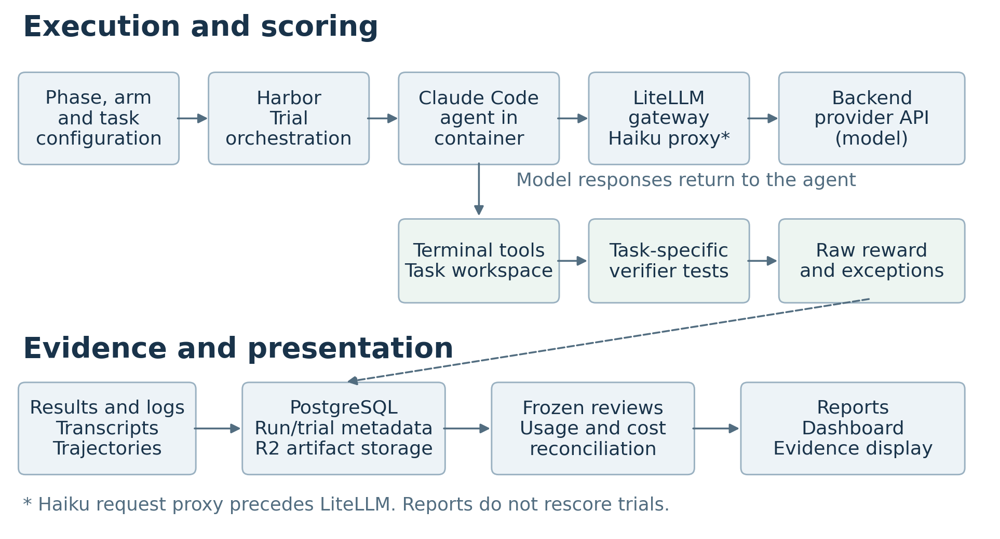
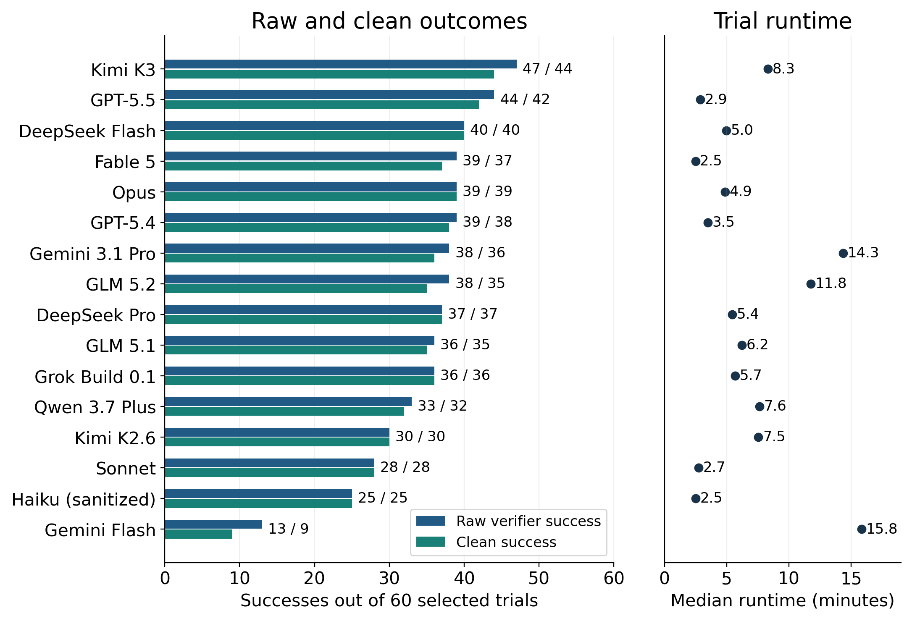
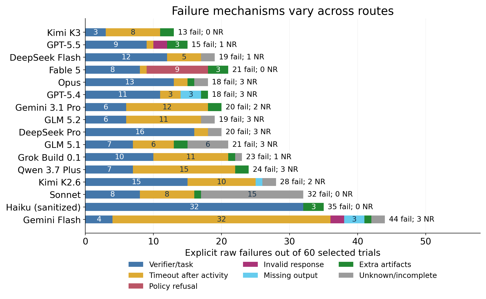
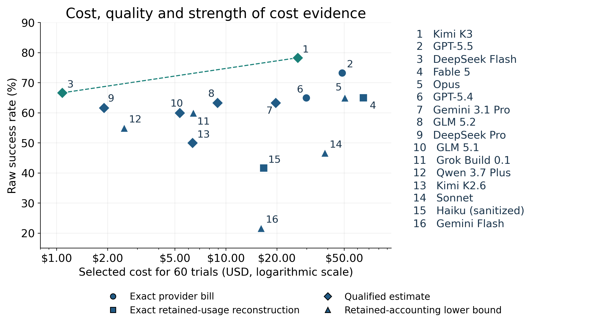
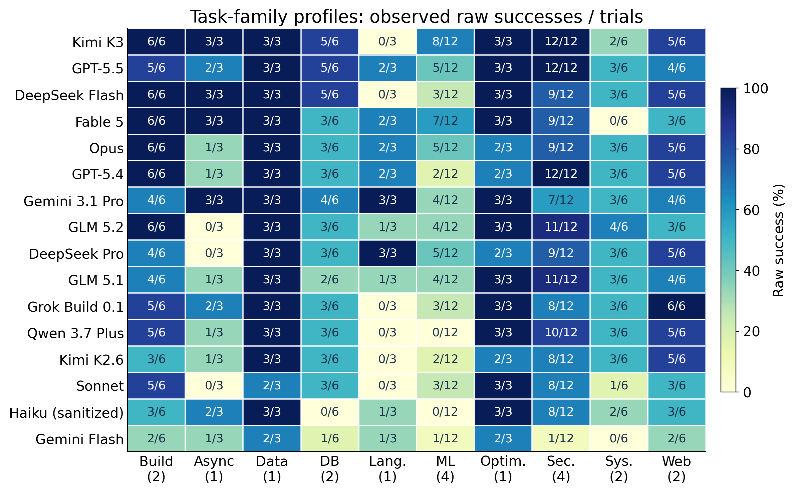
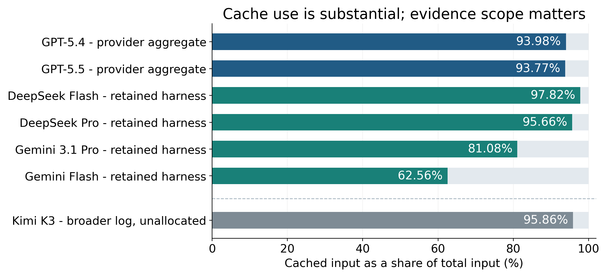
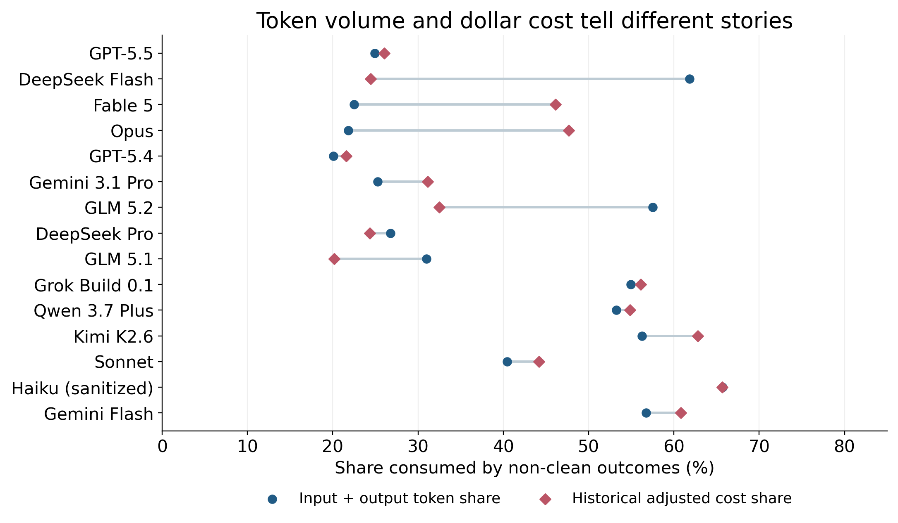

# Claude Code backend benchmark: quality, cost, and operational risk

**Integrated research report | Publication candidate | November 24, 2026**

Research portfolio: Nicholas Wagner · Claude Code Backend Benchmark project

Evidence: `nwags/cc-deepseek-benchmark`, committed `main` at `79f790f` (full identity and source chronology in Appendix A). The manuscript and PDF describe the historical reviewed evidence. The accompanying analytical tables preserve source precision; this edition is a publication candidate, not a new experiment. "Current" refers to the latest accepted interpretation in that evidence baseline, not present-day model availability or prices. References [S01]-[S41] link to the pinned public repository.

## Abstract

Choosing a coding-agent backend requires more than a pass-rate ranking or a list of token prices. We synthesize a historical benchmark that keeps Claude Code as the agent system while comparing model and provider routes on 20 selected Terminal-Bench 2.0 tasks, with three attempts per task. The reviewed core covers 15 configurations, called **arms**, and 900 trials. A compatible Kimi K3 addendum extends this to 16 arms and 960 trials. The extended population contains 562 task-test passes (58.54%); 543 (56.56%) are **clean successes**, meaning passes without a retained execution exception. DeepSeek Flash achieves 40 raw and 40 clean successes at a qualified estimated arm cost of $1.08. Kimi K3 has the highest observed counts, 47 raw and 44 clean, at a qualified estimate of $26.57. GPT-5.5 records 44 raw and 42 clean successes, an exact selected-run provider bill of $48.60, and a shorter median retained trial runtime than Kimi K3 (173 versus 499 seconds). The 16-arm selected-cost sum is $343.45, combining bills, retained-usage reconstructions, estimates, and lower bounds. Nine reviewed policy refusals occur in Fable; timeouts explain much of Gemini Flash's unsuccessful execution. Cache accounting materially changes cost interpretation, while comparable reasoning-versus-final-answer token totals are not established. These findings support a workload-specific shortlist, with explicit cost and operational qualifications. They do not establish statistical superiority, a causal router effect, or production-wide performance. This revision reproduces committed review data with fixed trial identities and checked file hashes; it does not independently rerun the full raw-artifact verification chain. [S03] [S06] [S08] [S10]

## 1. Introduction

A coding agent must turn a task description into working changes through repeated model calls, terminal commands, file edits, and tests. A lower unit token price can still produce a costly attempt if the agent repeats work, misses a requirement, or times out. A high success rate can also conceal exceptions, policy refusals, or incomplete evidence. Backend selection therefore requires correctness, operational behavior, elapsed time, and the strength of the cost evidence to be considered together.

**Claude Code** is the agent application in this study: it manages the interaction with a language model and the tools used to work on a task. A **backend** is the model/service answering its requests. A **route** is the API path between the agent and that backend. Phase 3 introduces a LiteLLM gateway that translates and forwards requests to several providers. The experiment tests these whole configured paths; it does not isolate a model's intrinsic ability from the surrounding software.

The project proceeded through three phases. Phase 1 tested three direct backend paths, Phase 2 expanded to five, and Phase 3 reviewed 15 router-mediated arms. Kimi K3 is an additional Phase-3-compatible arm, not Phase 4. Phase 1 and Phase 2 remain frozen, Phase 3 is closed, and this report activates no later phase. Historical and later reviewed accounting layers are retained separately because they answer different questions. [S01] [S02]

This report asks four questions: which tested routes deliver the strongest raw and clean success; how their failure mechanisms and task profiles differ; how a provider-aware cost comparison changes the practical shortlist; and what the retained token evidence can explain. Its practical finding is a three-way tradeoff: DeepSeek Flash is the low-cost reference in this workload, Kimi K3 has the highest observed score, and GPT-5.5 offers faster observed execution with exact aggregate billing. The evidence qualifications are part of those recommendations.

The report first defines the experiment and measurements, then presents the results and visualizations, discusses competing explanations and mitigations, and closes with recommendations. Appendices preserve the source chronology, claim matrix, testing record, and dashboard access limits so that the paper can be read without prior project context.

## 2. Methods

### 2.1 Experimental units and workload

An **arm** is one configured combination of model, provider, and API route. A **run** is an execution of that arm's workload. A **trial** is one attempt at one task within a run. A **selected run** is the exact run admitted by the accepted review; the analysis never substitutes a newer or similarly named run. A **manifest** is a file recording scope and content fingerprints, including hashes used to check that the reviewed files have not changed.

The workload is a manually selected 20-task subset of the 89 tasks described in the repository's Terminal-Bench 2.0 selection notes. It was stratified by visible task theme because the local Harbor interface did not expose a usable difficulty/category table. It is not a random or statistically representative sample. Themes include build tooling, concurrency, data processing, database recovery, language implementation, scientific and machine learning (ML) work, optimization, security, systems, and web administration. The exact task names and retained family labels are in `validation/task_profiles.csv` and the source taxonomy. [S17] [S28]

Each selected arm has 20 tasks x 3 attempts = 60 trials. The core therefore has 15 x 60 = 900 trials; adding Kimi K3 gives 16 x 60 = 960. "Full suite" in historical project documents refers to this selected workload, not the entire Terminal-Bench dataset. A pass rate here is successful attempts divided by all selected trials; it is not the probability of solving a task at least once in three attempts, often called `pass@3`. Smoke tests and canaries are small execution preflights retained outside the scored population. [S03] [S04]

### 2.2 Execution and evidence architecture

**Harbor** is the benchmark runner. The shared shell/Python runner combines a phase configuration, an arm configuration, and a task list into a Harbor command. Harbor starts task environments and invokes Claude Code to work inside them. The agent uses terminal/file tools, sends model requests through the configured route, and changes a task workspace. A **verifier** is the task-specific test program that checks the resulting workspace and records a reward. The benchmark's raw correctness comes from these verifiers, not a language-model judge. [S29] [S30]

*Figure 1. Historical platform architecture, simplified from the codebase guide and runner. Solid arrows show the principal execution or evidence flow; the dashed arrow denotes observation of execution. Provider responses return through the gateway to the agent. The selected Haiku route includes a compatibility sanitizer, which strips selected top-level request fields before forwarding to LiteLLM. For that arm, the order is Claude Code, sanitizer, LiteLLM, provider. The observation and presentation layers do not assign reward. This revision reads frozen files; it does not operate this platform. [S29] [S30] [S41]*

The execution side produces result files, agent transcripts, trajectories (the recorded sequence of agent/tool activity), verifier output, and exception logs. A separate observation/publication side records run/trial metadata in PostgreSQL and stores artifacts in Cloudflare R2 object storage. Completed accepted records are called **canonical** in the project; live records are provisional observations. Hash-bound reviewed snapshots then support reports and the dashboard. **Reconciliation** compares usage or cost sources and states which source is authoritative for a particular scope. This separation prevents a dashboard view, a partial live record, or a model's cost display from becoming an unqualified measurement authority. [S29] [S33]

### 2.3 Controls actually retained, and controls not established

The committed comprehensive review retains configuration metadata for all 960 selected trials. An additional offline audit in this revision reproduces the following observations. These are observations of the retained review, not newly downloaded run configurations. [S08] [S32]

| Setting | Retained evidence and interpretation |
|---|---|
| Task source revision | All 960 configurations name the same Terminal-Bench task-repository commit, `69671fbaac6d67a7ef0dfec016cc38a64ef7a77c`. Per-task checksum fields are not recorded. |
| Scoring | Verifier configuration is recorded as enabled for all 960 trials. |
| Timeout configuration | All 960 record `timeout_multiplier=1`. This is a multiplier on task/runtime settings, not a common absolute time limit. A timeout does not automatically erase a successful reward. |
| Agent version | Seven Claude Code versions are recorded, from 2.1.183 through 2.1.217. Some arms contain two versions. Appendix A gives counts. "Fixed harness" means the same agent application, not one identical binary throughout. |
| Tool restrictions | WebSearch and WebFetch are denied in all retained configurations. Another three interactive tools, EnterPlanMode, ExitPlanMode, and AskUserQuestion, are also denied in 780 trials; 180 record only the two web-tool denials. |
| Concurrency | The checked-in phase configuration defaults to four concurrent trials for full runs. The runner accepts overrides. This is a documented default, not proof that every historical selected run used identical concurrency. |
| Model identity | Every retained configuration has a route alias, but its separate resolved-model field is unrecorded. Provider-specific reconciliation, such as OpenAI's model-bearing exports, supplies additional identity evidence where available. An alias alone is not independent provider observation. |
| Environment and other controls | Harbor uses task container environments. This review does not establish a complete, uniform historical hardware/container-image digest, Harbor/LiteLLM version, sampling seed/temperature, reasoning budget, retry budget, or randomized run-order record for all arms. Those controls must not be assumed identical. |

The current phase/arm files describe the reusable execution machinery but retain some historical planning labels and stale descriptions. They do not supersede the exact selected-run manifests or retained run metadata. Historical invalid and quarantined diagnostics, including incompatible unsanitized Haiku paths, remain separate from the selected sanitized Haiku arm. The Haiku sanitizer removes top-level `output_config`, `thinking`, `reasoning_effort`, and `effort` request fields for its configured Haiku alias. This is a material route condition, not evidence of a common reasoning budget across arms. No control was repaired or rerun for this report. [S03] [S30] [S31] [S41]

### 2.4 Outcomes, diagnosis, and time measurements

A **raw success** is the accepted verifier success signal. An **explicit raw failure** is a recorded unsuccessful outcome. **Not recorded** means the raw outcome is absent; it is retained in the pass-rate denominator and receives no success credit. A **clean success** is a raw success without a retained benchmark exception. "Clean" is an accounting definition, not proof of an anomaly-free transcript.

Diagnosis is separate from scoring. A **policy refusal** records that the provider declined the requested behavior; a **timeout after meaningful activity** records work before a time limit; a **verifier/task failure** records failed task checks. An **invalid response path** is an execution/response problem rather than ordinary verified wrong work. Missing required output and extra output artifacts are distinguished. The residual category means the supported explanation remains unknown or incomplete. These labels describe evidence and do not award a hypothetical pass if an obstacle were removed.

The accepted independent failure/trajectory taxonomy is called **J2** in the repository. **DR-302** is the dashboard's display rule that partitions explicit raw failures into seven categories using fixed precedence; it does not replace those independent diagnostic axes or alter rewards. **DR-303** names the historical spend decomposition, and **DR-304** names the subsequent OpenAI provider-billing correction. These identifiers are historical project references, not additional experiments. [S08] [S09] [S25]

Runtime is the median of retained trial `runtime_seconds`: an end-to-end trial measure that can include agent work, tool use, and other trial overhead. It is not token-generation speed or provider response latency. Evidence completeness and confidence describe the retained review's ability to support a classification. They are categorical assessments, not numerical probabilities.

### 2.5 Cost authority and token definitions

**Selected cost** means the cost source chosen by the accepted current reviewed comparison for one exact arm run. The latest decision-facing layer is version 4 (**V4**), dated August 25; V3 is its August 24 predecessor. Historical adjusted costs remain historical measurements. All displayed USD amounts and ratios in this manuscript and its figures are rounded to the nearest cent, using decimal half-up rounding. Calculations and machine-readable validation files retain source precision; totals are summed before rounding, so adding displayed rows can differ by a cent.

| Cost term | What it supports |
|---|---|
| Exact provider bill | A provider-billed total matched to the selected run; in this corpus, the two OpenAI arms. Exact aggregate billing does not imply exact dollars per trial. |
| Exact retained-usage reconstruction | Complete accepted usage multiplied by accepted rates. The reporting relation is exact within that reconstruction; it is not a retained invoice. |
| Qualified estimate | Usage/rate reconstruction with stated limits, such as pricing dates, cache semantics, or run allocation. The point value has no measured error bar. |
| Lower bound | Known retained-accounting cost with unresolved additional usage/spend. The actual amount may be higher; no unsupported upper bound is supplied. |
| Accepted normalized absence | The standardized provider-evidence layer deliberately has no qualifying selected-run chain. This describes evidence availability, not a zero-dollar cost or an automatic ingestion failure. |

**Normalized** means represented under a common evidence schema. Its authority categories are narrower than some reporting categories. **Allocation** means a supported join from a cost to a trial or outcome; aggregate ratios alone do not create that join. Costs remain API/usage accounting under their source conditions, not total cost of ownership including labor, hardware, taxes, or all invoice adjustments. [S06] [S07] [S33]

A **token** is a model-specific unit of text representation. **Input tokens** are the prompt/context sent to the model; **cache-read tokens** are reused input credited by the applicable source. They are a subset of total input in the collapsed reporting totals and must not be added to it again. **Cache creation/write** can be a separately priced input category, especially in Anthropic-style accounting, and must be retained separately when the rates require it. **Output tokens** are the recorded generated-output usage; the available aggregates do not establish a consistent split into reasoning, tool-call text, and the final user-visible answer. **Thinking/reasoning events** are transcript metadata counted by the analyzer; they are not billable token counts. Section 3.5 reports what can and cannot be inferred from these categories. [S33] [S34] [S40]

### 2.6 Data reproduction and analytical approach

The review joins exact trial IDs, arm IDs, task IDs, attempts, and selected run labels. It verifies the comprehensive-review and J2 manifest hashes, byte counts, producer hashes, scope fingerprints, and source inputs. The committed checkout lacks a complete Phase 3 raw-results tree and Phase 3 combined CSV, so this is reproduction from accepted, manifest-bound derived evidence rather than a new raw-to-verifier audit. No original private provider export or remote artifact was reacquired.

Task families use the retained heuristic taxonomy; counts are joined to the exact 960 selected trials. A **Pareto frontier** contains arms for which no other arm has both no greater selected cost and no lower observed success, with at least one strict advantage. Its nominal point values do not incorporate unknown cost errors, runtime, or refusal risk. An exploratory paired task-cluster bootstrap resamples the 20 task identities, retaining each task's three-attempt average, to assess the Kimi K3 versus GPT-5.5 score difference. It uses seed 20261024 and 20,000 resamples; it is not a representative-population inference or a multiple-comparison-adjusted superiority test.

The October review reproduced the analytical checks, added configuration and token exports, and generated seven figures. This edition preserves the October scientific results and updates their presentation. Test provenance and unavailable live surfaces are explicit in Appendices C and D.

## 3. Results

### 3.1 Population, correctness, and retained runtime

| Reviewed scope | Arms | Trials | Raw success | Explicit raw failure | Raw outcome not recorded | Clean success |
|---|---:|---:|---:|---:|---:|---:|
| Phase 3 core | 15 | 900 | 515 (57.22%) | 357 | 28 | 499 (55.44%) |
| Phase 3 extended | 16 | 960 | 562 (58.54%) | 370 | 28 | 543 (56.56%) |

The pass-rate denominator retains every selected trial. The extended set has
**398 non-successes**, comprising 370 explicit raw failures and 28 not-recorded
outcomes. DR-302 partitions only the 370 explicit failures. Historical
"failure/incomplete" accounting uses a broader bucket and therefore need not
equal the DR-302 failure count. "Clean success" here is the reviewed accounting
definition: a success without a retained benchmark exception. It is not a claim
that the transcript is free from every anomaly. All 19 exception-bearing
successes have meaningful timeout evidence and remain raw successes. [S03]
[S04] [S08]

Every row below contains 60 trials. Runtime is the median of the committed
comprehensive review's retained `runtime_seconds`, not a fresh runtime test.

| Arm | Raw successes / 60 | Clean successes / 60 | Explicit failures | Not recorded | Median runtime (s) |
|---|---|---|---|---|---|
| Kimi K3 | 47 | 44 | 13 | 0 | 499.1 |
| GPT-5.5 | 44 | 42 | 15 | 1 | 173.4 |
| DeepSeek Flash | 40 | 40 | 19 | 1 | 298.7 |
| Fable 5 | 39 | 37 | 21 | 0 | 149.5 |
| Opus | 39 | 39 | 18 | 3 | 292.8 |
| GPT-5.4 | 39 | 38 | 18 | 3 | 209.5 |
| Gemini 3.1 Pro | 38 | 36 | 20 | 2 | 860.3 |
| GLM 5.2 | 38 | 35 | 19 | 3 | 705.7 |
| DeepSeek Pro | 37 | 37 | 20 | 3 | 325.7 |
| GLM 5.1 | 36 | 35 | 21 | 3 | 373.8 |
| Grok Build 0.1 | 36 | 36 | 23 | 1 | 341.2 |
| Qwen 3.7 Plus | 33 | 32 | 24 | 3 | 457.9 |
| Kimi K2.6 | 30 | 30 | 28 | 2 | 452.9 |
| Sonnet | 28 | 28 | 32 | 0 | 164.2 |
| Haiku (sanitized) | 25 | 25 | 35 | 0 | 149.7 |
| Gemini Flash | 13 | 9 | 44 | 3 | 949.4 |

Display names map to canonical arm IDs and exact selected run labels in
`validation/arm_comparison.csv`. No alternate run is substituted.

Kimi's 5-point raw lead over GPT-5.5 is only three additional successes. An
exploratory paired task-cluster bootstrap, preserving each task's three-attempt
average, gives an approximate 95% percentile interval of **-10.0 to +21.67
percentage points** for Kimi minus GPT-5.5. This sensitivity analysis resamples
these 20 selected tasks; it does not justify statistical superiority or
representative-workload confidence. The clean-success difference is two trials.

*Figure 2. Raw and clean success counts (left) and median end-to-end trial runtime (right) for the same 16 selected runs. Arms are ordered by raw success; ties are presentation order. Pair labels give raw / clean counts. Counts retain all 60 trials per arm. Short runtime can accompany poor correctness or early refusal and is not a standalone efficiency ranking. Data: `validation/arm_comparison.csv`. [S06] [S24]*

### 3.2 Failure, refusal, and trajectory findings

| DR-302 display category | Explicit raw failures | Share of 370 |
|---|---:|---:|
| Verifier/task failure | 167 | 45.14% |
| Timeout after meaningful activity | 127 | 34.32% |
| Provider-policy refusal | 9 | 2.43% |
| Invalid response path | 4 | 1.08% |
| Missing required output | 7 | 1.89% |
| Extraneous output artifacts | 22 | 5.95% |
| Unknown/incomplete evidence | 34 | 9.19% |
| **Total** | **370** | **100%** |

Figure 3 visualizes this partition by arm. The partition uses explicit presentation precedence and preserves the
independent J2 axes. The 19 successful timeout anomalies and 28 not-recorded
outcomes remain outside it. Across all 960 trials, 174 have activity classified
as timeout after meaningful activity: 127 explicit failures, 19 successes, and
28 not-recorded outcomes. A timeout marker alone cannot determine correctness.

The following contrasts are supported by the frozen joined rows:

- **Gemini Flash:** 32 of its 44 explicit failures are timeout-after-meaningful-
  activity cases. It has only 9 clean successes, three not-recorded outcomes,
  and a median retained runtime near 949 seconds. Low observed success should
  not be reduced to a generic wrong-code rate.
- **Sanitized Haiku:** 32 of 35 explicit failures fall in verifier/task failure,
  and three in extraneous artifacts. Its cheap model class did not guarantee
  high task success. The selected sanitized run is distinct from historical
  invalid unsanitized/service-failure diagnostics.
- **Kimi K3:** eight of 13 failures are timeout-after-meaningful-activity, three
  verifier/task failures, and two extraneous artifacts; three additional
  timeout-bearing trials succeeded. Its high aggregate score coexists with
  operational timeout risk.
- **Fable:** all nine reviewed provider-policy refusals occur in this arm
  (15% of its 60 trials; 9/21 explicit failures), across three task identities
  with three attempts each. Six have refusal-only activity classification;
  three show meaningful activity before the policy event. It also has eight
  verifier/task failures, three extraneous-artifact failures, and one timeout
  failure. None of the other 15 arms has a reviewed policy-refusal label.
- **Sonnet:** 15 of 32 failures occupy the residual unknown/incomplete display
  category, with eight verifier/task failures, eight meaningful-activity
  timeouts, and one extraneous-artifact failure. This limits explanations of
  the direct-versus-routed score difference. [S08] [S09]

Six deterministic representative/counterexample traces are retained in
`validation/evidence_traces.json`, with exact trial/run identity, independent
review/J2 fields, completeness, and supporting artifact IDs. These trace
committed review evidence; they do not claim fresh full-artifact reads.

The safe refusal index contains the nine exact public trial IDs, selected run,
attempt, completeness state, and supporting artifact IDs. It reproduces no
task payloads, refusal excerpts, credentials, or provider account identifiers.
All nine show canonical `9/9` artifact completeness in the retained review;
that historical assertion is not a new R2 download/integrity check.

The 34 residual failures are not all missing-artifact cases. The accepted
display model distinguishes 27 complete-evidence/no-substantive-attempt cases
and seven incomplete/indeterminate cases. Across the entire review, 911 trials
have complete/high-confidence evidence and 49 incomplete/medium-confidence
evidence. Router observability is `unknown` for all 960, so these classifications
do not localize fault to a provider or router. [S08] [S09]

*Figure 3. Fixed-precedence diagnostic categories for the 370 explicit raw failures. "NR" is the number of not-recorded outcomes per arm and is printed separately, not included in the stacked bars. The 19 successful timeout anomalies are also excluded. Data: `validation/failure_composition_by_arm.csv`. [S08] [S09] [S25]*

### 3.3 Costs and evidence strength

#### 3.3.1 Selected-arm ledger

All displayed amounts below are rounded to cents; the companion CSV retains full calculation precision. "Exact reconstruction" means
complete retained-usage accounting under accepted rates; it does **not** mean an
invoice was available. A cost-per-clean-success figure is an aggregate arm
total divided by the clean-success count, not the dollars allocated to a
particular successful trial. [S06] [S07]

| Arm | Selected arm cost | Authority / qualification | Cost / clean count | Outcome allocation |
|---|---|---|---|---|
| Kimi K3 | $26.57 | Qualified rate estimate | $0.60 | Unavailable: no reviewed outcome join |
| GPT-5.5 | $48.60 | Exact provider bill | $1.16 | Unavailable: provider aggregate |
| DeepSeek Flash | $1.08 | Qualified rate estimate | $0.03 | Available with stated basis |
| Fable 5 | $64.81 | Exact retained-usage reconstruction; normalized absence | $1.75 | Available with stated basis |
| Opus | $50.29 | Retained-usage lower bound | $1.29 | Available with stated basis |
| GPT-5.4 | $29.79 | Exact provider bill | $0.78 | Unavailable: provider aggregate |
| Gemini 3.1 Pro | $19.70 | Qualified rate estimate | $0.55 | Available with stated basis |
| GLM 5.2 | $8.90 | Rate estimate; normalized absence | $0.25 | Available with stated basis |
| DeepSeek Pro | $1.90 | Qualified rate estimate | $0.05 | Available with stated basis |
| GLM 5.1 | $5.33 | Partial estimate; normalized absence | $0.15 | Available with stated basis |
| Grok Build 0.1 | $6.42 | Retained-usage lower bound | $0.18 | Available with stated basis |
| Qwen 3.7 Plus | $2.50 | Retained-usage lower bound | $0.08 | Available with stated basis |
| Kimi K2.6 | $6.35 | Qualified rate estimate | $0.21 | Available with stated basis |
| Sonnet | $38.39 | Retained-usage lower bound | $1.37 | Available with stated basis |
| Haiku (sanitized) | $16.70 | Exact retained-usage reconstruction; normalized absence | $0.67 | Available with stated basis |
| Gemini Flash | $16.12 | Retained-usage lower bound | $1.79 | Available with stated basis |

There are two different count systems:

| Layer | Exact/billed | Estimates | Lower bounds | Accepted normalized absence |
|---|---:|---:|---:|---:|
| V4 reporting relations, all 16 arms | 4 exact relations, including **2 bills and 2 retained-usage reconstructions** | 7 | 5 | Not a reporting relation |
| August 28 normalized authority | **2 exact provider-billed** | 5 qualified | 3 qualified | 6 (4 Anthropic, 2 GLM) |

All 16 arms have reporting reconciliation rows. Only ten have normalized
selected-run usage/cost chains. Anthropic's four accepted absences reflect no
retained first-party selected-run source under the reviewed evidence/credential
set; the separate Admin credential is required by its collector. GLM 5.1's
historical provider context is not allocable to the selected run; comparable
selected-run first-party evidence was not retained for GLM 5.2. Neither absence
means zero cost or automatic ingestion failure. [S07] [S14]

Six arms retain unquantified additional-cost exposure: Opus, Sonnet, Gemini
Flash, GLM 5.1, Grok, and Qwen. GLM 5.1 is a **partial estimate**, not a strict
lower bound, because five trials remain unresolved and cache classification is
unverified. Qwen's discounted regional rates and per-request context tier are
part of its qualified lower-bound basis. Gemini Pro's request-level tier audit
resolved the applicable below-200K rate; the selected maximum retained prompt
was 66,438 tokens. These qualifications are specific to the historical selected
runs. [S06]

#### 3.3.2 Accounting chronology

| Reviewed layer | Core arm cost sum | Extended arm cost sum | Meaning |
|---|---:|---:|---|
| August 5 historical layer | $972.17 | $1,002.98 | Historical benchmark-side adjusted core plus qualified Kimi provider-log reconstruction |
| August 21 / DR-304 | $682.96 | $713.78 | Exact OpenAI corrections; other costs retain the then-selected historical basis |
| August 24 / V3 | $510.41 | $541.22 | Intermediate provider-aware successor |
| August 25 / V4 | $316.88 | $343.45 | Latest selected-arm evidence mixture; no historical fallback arms |

These are arithmetic sums of arm values, not a sequence of fully exact bills.
The historical source has tiny floating-point reconciliation differences between scope fields, decimal arm sums, and trial-row sums, all smaller than one cent. The validation files retain their exact source values and residuals; they do not affect the displayed totals or justify altering frozen evidence.

#### 3.3.3 Independently supported OpenAI correction

| Selected arm | Historical harness-recorded | Historical adjusted | Exact selected provider bill |
|---|---:|---:|---:|
| GPT-5.4 | $173.09 | $183.65 | **$29.79** |
| GPT-5.5 | $168.71 | $183.96 | **$48.60** |

The exact selected sum is **$78.40**, distinct from the broader project-
period provider total of **$95.24**. Sanitized provider records support the
reviewed reconciliation; private raw exports were not re-obtained in this
review. Provider input was approximately 94% cached for each selected sweep.

The retained GPT-5.4 canary independently reproduces the unrounded client-price fingerprint in the validation outputs: 146,861 input tokens x $5.00 per million tokens plus 2,602 output tokens x $25.00 per million tokens equals
**$0.80**, with zero retained cache tokens. The displayed result is rounded only after the full-precision calculation. Cost propagated from Claude
Code's `total_cost_usd` through Harbor's `agent_result.cost_usd`, ingestion, and
historical reporting. The retained full-sweep reconciliation documents the
same pricing/cache mismatch. This supports an upstream telemetry/accounting
defect; it does not establish one exact dependency release or the precise
estimator dispatch mechanism. Custom routing and compatibility translation are
supported explanatory leads, with that mechanism unresolved. [S10] [S15]

OpenAI's exact totals are aggregate-only. Trial and outcome provider-cost
allocation remain `unavailable_provider_aggregate`. No historical success or
failure shares are applied to those totals.

#### 3.3.4 Kimi's three distinct amounts

Kimi K3 retains **$25.21** in observed trial costs, **$30.81** from the
broader provider-request-log retained-rate reconstruction, and **$26.57** as
the current selected-run estimate. The broader log has 1,273 requests and 95.86% cached input, but its timezone and request-to-run/trial allocation are not established.
It cannot automatically replace the cleaner selected-run reconstruction.
Official dated pricing provenance remains incomplete. V4 supports selected
trial-rate reconstruction but records
`unavailable_no_reviewed_outcome_join` for outcome allocation. That prevents
claiming a selected Kimi failure-spend total. [S04] [S06] [S16]

#### 3.3.5 Failed and operationally unclean spend

The July core historical layer records **$820.77**, reconstructs missing
cost where feasible, and reaches **$972.17** adjusted known cost. It
has 179 missing recorded-cost rows, 150 reconstructed rows, and 29 unresolved
rows. Historical failure/incomplete spend is **$335.76**; including
exception-bearing successes gives approximately **$364.29** unclean
spend. The corresponding historical token volumes are 213,482,015 and
218,979,987 input-plus-output tokens. Cache tokens are a subset and are not
added again. These are historical diagnostics, not allocations of current
provider billing. [S05] [S20]

Where V4 has an outcome join, current selected failed/unclean spending can be
examined within its own authority. Examples are Flash **$0.60** on
non-success outcomes (55.43% of its selected estimate), sanitized Haiku
**$10.96** (65.65%), and GLM 5.2 **$5.44** including exception-bearing
successes (61.15%). Flash's historical unclean-spend share was 24.4%; carrying
that old fraction into the current cost layer would be misleading. There is
**no complete current 16-arm outcome-spend decomposition**: the two OpenAI arms
and Kimi K3 lack the required selected-outcome allocation.

*Figure 4. Selected arm cost for 60 trials versus raw success rate. The logarithmic cost axis accommodates the wide cost range. Circles distinguish exact provider bills from squares for exact retained-usage reconstructions; diamonds indicate estimates and triangles indicate lower bounds. The dashed segment connects the nominal two-arm frontier, DeepSeek Flash and Kimi K3. No error bars are drawn because the accepted evidence supplies no common quantified cost-error distribution. This is not an assurance-, latency-, or risk-adjusted frontier. Data: `validation/arm_comparison.csv`. [S06] [S07]*

### 3.4 Task-family profiles

Task families are a retained heuristic taxonomy, not benchmark ground truth.
Some families contain one task. The following new extended counts join the
same taxonomy to the exact 960 reviewed trial IDs; they are kept separate from
the original July core findings. No selected provider cost is allocated to
families without a supported join. [S05] [S17]

| Heuristic family | Tasks | Historical core raw | Extended raw | Extended clean |
|---|---|---|---|---|
| build-packaging | 2 | 70/90 (77.8%) | 76/96 (79.2%) | 74/96 |
| concurrency-async | 1 | 21/45 (46.7%) | 24/48 (50.0%) | 21/48 |
| data-processing | 1 | 43/45 (95.6%) | 46/48 (95.8%) | 45/48 |
| database-storage | 2 | 44/90 (48.9%) | 49/96 (51.0%) | 47/96 |
| language-implementation | 1 | 18/45 (40.0%) | 18/48 (37.5%) | 14/48 |
| ml-scientific | 4 | 48/180 (26.7%) | 56/192 (29.2%) | 53/192 |
| optimization-finance | 1 | 40/45 (88.9%) | 43/48 (89.6%) | 43/48 |
| security-crypto | 4 | 132/180 (73.3%) | 144/192 (75.0%) | 143/192 |
| systems-low-level | 2 | 37/90 (41.1%) | 39/96 (40.6%) | 38/96 |
| web-networking | 2 | 62/90 (68.9%) | 67/96 (69.8%) | 65/96 |

Four-arm profiles illustrate why aggregate leadership is insufficient:

| Family | Flash | GLM 5.2 | GPT-5.5 | Kimi K3 |
|---|---:|---:|---:|---:|
| Build/packaging (2 tasks) | 6/6 | 6/6 | 5/6 | 6/6 |
| Concurrency/async (1 task) | 3/3 | 0/3 | 2/3 | 3/3 |
| Database/storage (2 tasks) | 5/6 | 3/6 | 5/6 | 5/6 |
| Language implementation (1 task) | 0/3 | 1/3 | 2/3 | 0/3 |
| ML/scientific/retrieval (4 tasks) | 3/12 | 4/12 | 5/12 | 8/12 |
| Security/crypto/recovery (4 tasks) | 9/12 | 11/12 | 12/12 | 12/12 |
| Systems/low-level (2 tasks) | 3/6 | 4/6 | 3/6 | 2/6 |

Kimi leads these four on ML/scientific counts but has no language-implementation
success and a weaker systems count. GPT-5.5 is a counterexample to assuming
Kimi's aggregate lead applies to every family. GLM 5.2's security strength
coexists with 0/3 on the single async task. Such small cells support follow-up
questions, not dependable production routing rules.

At task level, `polyglot-rust-c` is 1/48, model extraction 3/48, query
optimization 8/48, retrieval 9/48, and pipeline parallelism 12/48. At the other
end, scientific-stack modernization and data merging are each 46/48. The
systems family combines 38/48 on memory debugging with 1/48 on polyglot work;
its aggregate therefore hides a large within-family difference. Full counts
are in the attached task and family CSVs; no solution content is included.

*Figure 5. All 16 arms against the ten retained heuristic task families. Every cell prints raw successes and its denominator; color represents the corresponding percentage. A one-task family has only three attempts per arm. A saturated cell is not evidence of broad domain mastery. Abbreviations: DB, database/storage; Lang., language implementation; ML, scientific/machine learning; Optim., optimization/finance; Sec., security; Sys., systems. Data: `validation/task_family_profiles.csv`. [S08] [S17] [S24]*

### 3.5 Token categories, cache effects, and missing generated-token splits

The evidence does support token-type-associated findings, principally about input caching and the limits of generated-output accounting. It does **not** support a comparable 16-arm table of reasoning tokens versus final-answer tokens. Treating all output as final-answer text, or treating a count of thinking events as a token count, would invent a measurement the retained sources do not establish.

#### 3.5.1 Input caching changes the economic interpretation

| Selected arm | Total input | Cached input share | Recorded output | Evidence scope |
|---|---:|---:|---:|---|
| GPT-5.4 | 32,807,457 | 93.98% | 1,143,269 | Selected-run provider aggregate |
| GPT-5.5 | 35,226,942 | 93.77% | 704,066 | Selected-run provider aggregate |
| DeepSeek Flash | 102,663,832 | 97.82% | 1,733,059 | Qualified selected harness/session usage |
| DeepSeek Pro | 44,293,924 | 95.66% | 1,046,381 | Qualified selected harness/session usage |
| Gemini 3.1 Pro | 25,122,141 | 81.08% | 509,693 | Qualified selected harness/session usage |
| Gemini Flash | 17,250,634 | 62.56% | 534,977 | Retained usage for 56/60 trials; incomplete |

Input totals already include the cached subset. "Other input" is input minus cache-read; it is not necessarily an independently measured ordinary-versus-cache-write split. OpenAI's aggregate exports establish cached versus uncached input but no separate cache-creation quantity. DeepSeek's retained cache-miss representation combines categories that cannot be separated further from those totals. Missing dimensions remain unavailable rather than zero. [S33] [S35] [S36] [S37] [S38]

*Figure 6. Cached input shares for six selected runs, with source authority in the row labels. Kimi K3 is shown below the dashed divider because its 95.86% share comes from a broader provider request log with unproven run allocation; it is not a seventh selected-run aggregate. Blue denotes selected provider aggregates, teal selected retained harness usage, and gray the broader unallocated log. These rows are not a complete cross-provider token census. Data: `validation/token_usage_scopes.csv`. [S16] [S35] [S37] [S38]*

For both OpenAI sweeps, historical benchmark-side cache counters sum to zero, while the accepted provider exports show about 94% cached input. Provider and harness input/output totals also differ, so they are not interchangeable request-for-request records. Together with the retained canary's incorrect client-price fingerprint, this supports using the later provider-billed totals for cost decisions. It does not identify the precise dependency release, estimator dispatch path, or a trial-level source of each discrepancy. [S10] [S15] [S35]

DeepSeek Flash's high input volume is therefore compatible with a very small selected cost estimate under the accepted cache-aware rates. Kimi K3's broader log similarly shows why adding "Input Tokens" and "Cached Tokens" would double-count reused input. Its 39,996,874 total input tokens include 38,341,888 cached tokens, alongside 956,453 output tokens. The broader log's $30.81 rate reconstruction remains distinct from the selected $26.57 estimate and is not invoice-level evidence. High cache use explains arithmetic under source-specific rates; this observational study does not establish that caching caused a particular success rate or runtime. [S16] [S37]

#### 3.5.2 Thinking metadata is not a reasoning-token budget

The frozen review records nonzero thinking/reasoning event metadata in **868 of 960 trials**; 92 have no such recorded event. The analyzer increments this counter for a system `thinking_tokens` event or a thinking/reasoning content node, without preserving the hidden content. All 960 evidence records state that hidden reasoning content is not retained. Event granularity can differ by route and transcript format. The counts cannot be interpreted as a common number of model reasoning steps or billed reasoning tokens. [S32] [S34]

The distinction is substantial: median event counts range from zero in sanitized Haiku to thousands in several routes. Haiku's zero means no event of that type was recorded, not that its model performed no internal reasoning. Its sanitizer also strips submitted thinking/effort configuration fields, which further limits reasoning-budget comparisons across routes. [S41] The companion export reports event presence and counts explicitly as **NOT tokens**. This paper does not rank reasoning efficiency from them.

| Token/response category | What is measured | Defensible finding or limit |
|---|---|---|
| Total input and cache-read input | Provider aggregates for OpenAI; qualified harness/session or broader-log evidence for selected other sources | Caching is economically material; preserve each source's scope and completeness. |
| Cache creation/write | Required as a separate category where pricing distinguishes it; not separately established by many collapsed totals | Do not silently price cache writes as ordinary input or replace unavailable fields with zero. |
| Generated output | Aggregate output usage is retained in the sources above | It is not a standardized final-answer-only count; different tokenizers and routes prevent a universal efficiency interpretation. |
| Thinking/reasoning events | Analyzer event metadata for all 960 reviewed trials | 868 show recorded activity of this type; event counts do not establish reasoning-token volume or dollars. |
| Reasoning tokens versus final-answer/tool-call tokens | No comparable selected 16-arm split established by this review | No reasoning cost share, reasoning-per-success rank, or final-answer efficiency result is claimed. |

#### 3.5.3 Generated output and outcome are associated differently by arm

Within the exact 900-trial core, the historical token table can be joined to the later raw outcomes. The table below summarizes four illustrative arms; the companion CSV covers all 15. An observation is included in the median only when retained input plus output usage is positive. The displayed fractions show observations included over all trials in that outcome group; zero/absent aggregates are not treated as proof of zero provider work.

| Arm | Success obs. | Median output (success) | Non-success obs. | Median output (non-success) |
|---|---:|---:|---:|---:|
| DeepSeek Flash | 40/40 | 5,442.5 | 20/20 | 35,036 |
| GPT-5.5 | 44/44 | 6,033 | 14/16 | 4,735 |
| Haiku (sanitized) | 25/25 | 3,260 | 35/35 | 7,991 |
| Fable 5 | 39/39 | 4,266 | 15/21 | 4,780 |

For Flash and sanitized Haiku, unsuccessful attempts with retained usage have substantially higher median generated-output counts than successful attempts. GPT-5.5 shows the opposite direction in the retained observations. More output is therefore not a universal signal of a correct solution. These are descriptive associations: outcome groups differ in task difficulty, activity, timeouts, and evidence completeness. Output includes the source's aggregate generated usage, not an isolated final answer. No causal effect of verbosity or reasoning is estimated, and no Kimi K3 row is fabricated from the broader request log. Data: `validation/output_tokens_by_outcome.csv`. [S20] [S24]

#### 3.5.4 Failed work can consume tokens without a proportionate dollar share

The July core accounting records 213,482,015 input-plus-output tokens on failure/incomplete outcomes and 218,979,987 on all non-clean outcomes. Cache-read tokens are already included in input. These are historical benchmark-side totals for the 900-trial core; they must not be relabeled as a current 960-trial provider-token total. [S20] [S39]

*Figure 7. Within the July historical core accounting, non-clean outcomes' share of input-plus-output tokens versus their share of adjusted cost. Connecting lines compare two measures within the same arm; they are not time trends. DeepSeek Flash uses about 61.8% of its tokens on non-clean outcomes but about 24.4% of its historical adjusted cost. The chart deliberately uses historical costs to match the token source and is not an allocation of V4 provider bills. Data: `validation/historical_token_and_spend_shares.csv`. [S39]*

This difference shows why token volume alone is an inadequate spending metric. Prices differ by input/output/cache class, and missing evidence differs by outcome and route. Even a well-supported aggregate output count would not by itself establish useful work, answer quality, or the causal benefit of more reasoning.

## 4. Discussion and recommendations

**For a budget-constrained workload resembling this subset, use DeepSeek Flash
as the historical value reference.** Its 40/60 raw and clean score is supported
at a selected estimated cost near $1.08. DeepSeek Pro costs more here and
scores lower, so this experiment supplies no aggregate quality-cost reason to
prefer Pro; a different task mix could change that conclusion.

**For the highest observed score, shortlist Kimi K3 with its evidence and
timeout qualifications.** It lies with Flash on the nominal selected-cost/raw-
quality frontier; using clean success produces the same two frontier arms.
That frontier is descriptive and uses mixed-authority point values. It does
not resolve estimate uncertainty, latency, policy behavior, or incomplete
accounting. It differs from the five-arm historical July frontier because both
cost authority and corpus membership changed.

**For exact-billing assurance and faster observed execution, retain the OpenAI
options.** GPT-5.5 has higher raw/clean counts than GPT-5.4 at greater exactly
billed aggregate cost. Kimi's higher observed quality and lower estimated cost
do not make it dominate GPT-5.5 on evidence assurance or runtime. The exact-
provider-billed-only comparison contains two OpenAI arms, which is a restricted
evidence subset, not proof that other providers are inferior.

**Evaluate GLM 5.2 as a qualified lower-cost alternative where its task profile
fits.** Its $8.90 selected estimate, 38 raw/35 clean successes, timeout
profile, and accepted normalized absence should travel together. Treat Fable's
refusal cluster and the weak Sonnet/Gemini Flash route observations as tested-
configuration risks; do not generalize them to all versions or harnesses.

Future work could test task-specific hypotheses and examine representative failure counterexamples. Better provenance and matched execution controls would strengthen attribution. Independent experimental confirmation would require a new study; no new trials are reported here. [S01] [S02] [S11]

## 5. Challenges to the findings, mitigations, and residual uncertainty

The main competing explanations concern what was selected, what changed across runs, and what the instruments could observe. The table distinguishes controls actually present from questions that remain open. A documented mitigation reduces a concern; it does not prove the concern absent.

| Challenge to interpretation | Mitigation used in the retained study or this review | Residual uncertainty / claim boundary |
|---|---|---|
| The 20 tasks may favor particular arms; three attempts are dependent observations. | Same task IDs and 20x3 shape checked for every selected arm; task/family counterexamples shown; paired bootstrap resamples tasks rather than treating 60 trials as independent task draws. | Manual public subset; one selected run per arm; small family cells; no universal ranking or adjusted multi-arm superiority claim. |
| Configuration drift rather than the backend could explain score/runtime differences. | Retained configuration audit exposes seven agent versions, shared task commit, timeout multiplier, tool denials, and the special Haiku path; exact selected-run IDs are preserved. | No randomized same-time, same-version route ablation or complete hardware/retry/reasoning-budget record; no causal router effect. |
| Public tasks or internet access could contaminate results. | WebSearch/WebFetch denied in the retained Phase 3 configurations; the project maintains contamination audits and preserves historical exposure instead of rewriting scores. | Actual Phase 1/2 web-tool events are documented. Tool denial is not network isolation or a memorization test; a historical `allow_internet=false` diagnostic still allowed public egress. Selected Phase 3 contamination-free execution was not freshly established. |
| A verifier pass may coexist with poor execution, and failure categories may obscure uncertainty. | Raw and clean success reported separately; 19 successful timeout anomalies retained as successes; seven-category failure partition kept separate from independent J2 axes; residual cases and confidence shown. | Verifiers test task requirements, not all production quality. No fresh independent review of every solution; diagnostic labels do not uniquely identify provider/router fault. |
| Missing outcomes, artifacts, or costs could make a route look better or cheaper. | All selected trials stay in the denominator; 28 unrecorded outcomes receive no success credit; lower bounds/partial estimates are labeled; source manifests and hashes checked. | Evidence may be missing non-randomly. 49 reviews are incomplete/medium confidence; missing spend is not fully bounded. No favorable exclusion or zero filling is justified. |
| Cost rankings may reflect telemetry defects or mismatched accounting windows. | Bills, reconstructions, estimates, lower bounds, and accepted absence are distinguished; chronology retained; OpenAI correction and Kimi scope differences exposed; unsupported outcome allocations prohibited. | Original private exports and live normalized inventory were not reacquired; Kimi dated pricing and run/outcome joins remain qualified. The nominal frontier has no common quantified cost-error interval. |
| Thinking events, output usage, or cache counters may measure different things across APIs. | Token glossary and source-scoped table; cache subset geometry checked; provider/harness mismatch disclosed; hidden content omitted; event metadata never treated as token counts. | No comparable 16-arm reasoning-versus-final token split or reasoning-cost efficiency result. Recorded zero is not proof of absence. |
| Retrospective run selection or many exploratory views could favor a narrative. | Accepted August run selection used exactly; alternate invalid/smoke/canary runs excluded consistently; 16 arms and weak/counterexample task cells remain visible. | The review is retrospective, not a preregistered randomized experiment. More granular exploratory patterns need independent confirmation. |
| The report could appear more independently verified than it is. | Manifest-bound committed data reproduced; exact test and 16-surface access matrices supplied; prior test logs distinguished from revision checks. | Full Phase 3 raw tree/combined CSV absent locally; no fresh R2/provider/DB audit or rendered dashboard walkthrough. All 960 retain unknown router observability. |

Public task exposure is documented in [S18]. The retained evidence supports 911 complete/high-confidence and 49 incomplete/medium-confidence reviews; those historical assessments are not a fresh remote-artifact integrity guarantee. The live dashboard, database, private provider exports and remote raw artifacts were not independently reverified. These limits apply to all conclusions in this report.

## 6. Conclusion

On this selected historical workload, backend choice changes correctness, operational behavior, runtime, and the meaning of a cost estimate. DeepSeek Flash supplies the strongest low-cost reference: 40 raw and clean successes at an estimated $1.08 for 60 trials. Kimi K3 records the highest score, 47 raw and 44 clean, at an estimated $26.57, while GPT-5.5 combines 44 raw and 42 clean successes with faster median retained execution and an exact $48.60 aggregate provider bill. The three-success Kimi lead over GPT-5.5 does not establish statistical superiority.

The useful result is a qualified shortlist rather than a universal winner. Failure mechanisms and task-family counterexamples constrain deployment inferences. Cache-aware and provider-aware reconciliation materially changes the economic reading of the same scored trials; the $343.45 extended selected-cost sum remains a mixture of evidence classes. Thinking-event metadata and aggregate output usage do not supply a comparable reasoning-versus-final-answer token analysis.

This is a retrospective synthesis of the accepted historical evidence, not a new benchmark or an end-to-end revalidation of the original infrastructure. Phase 1/2 remain frozen, Phase 3 remains closed, and Kimi K3 remains its compatible addendum.

## Appendix A. Source authority, chronology, and frozen baselines

### A.1 Authority and chronology

| Evidence milestone | Authority retained in this report |
|---|---|
| July 12 cost coverage; July 13 benchmark/sponsor reports; July 14 closeout index and task audit; July 16 comprehensive/router analysis | Original 15-arm/900-trial core; historical benchmark-side recorded/reconstructed costs; original heuristic task-family and behavioral findings. Older frontier and routing-cost claims stay historical. |
| July 22 Kimi K3 addendum | One additional reviewed 60-trial run, with 47 raw and 44 clean successes. |
| Comprehensive review folder dated July 31, generated August 2 | Manifest-bound 960-trial qualitative review; folder date is not generation time. |
| August 5 extended comparison | Frozen 16-arm quality scope and historical qualified extended cost, including the Kimi provider-log estimate with allocation qualifications. |
| August 9 run selection | Exact reviewed run labels; no "latest similar run" substitution. |
| August 13 J2 taxonomy, subsequently retained under its manifest | Independent response-path, verifier, assertion, and trajectory axes; interpretation does not rescore reward. DR-302 (defined in Section 2.4) later partitions raw failures for display. |
| August 21 comparison / DR-304 | Exact aggregate OpenAI provider-cost correction; all other arm costs still came from the then-selected historical layer. Preserved intermediate authority. |
| August 24 V3; August 25 ledger and V4 | Additive successor selected-cost layers. V4 is the decision-facing cost source wired into the current dashboard. |
| August 28 cross-provider consistency, with August 30 clarifications | Normalized authority/accepted-absence contract; OpenAI nonselected-source repair and Anthropic closure do not alter selected costs. |
| August 31 guides and handoff; August 31 ingestion/relay plans | Present-tense operating/status guidance. The new acquisition/relay designs are planning only, not deployed capability or authorization. |

This ordering resolves apparent conflicts without editing history. In
particular, the root operating guide still names the August 21 comparison as a
starting point; the later guides, V4 generator, and dashboard loader identify
August 25 as the current decision-facing layer. Historical July merge notes
describing `main` as the Phase 1 baseline do not override live `main` or the
August handoff. Markdown controls over convenience PDFs. [S01] [S02] [S03] [S04] [S05] [S06] [S07] [S08] [S09] [S10] [S11] [S23] [S26] [S27]

### A.2 Frozen direct-path baselines

| Phase | Canonical arm | Successes | Recorded effective cost | Missing cost rows | Median wall clock (s) |
|---|---|---|---|---|---|
| phase1 | arm-a-anthropic | 39/60 | $37.30 | 0 | 255.7 |
| phase1 | arm-b-deepseek-pro | 42/60 | $2.01 | 0 | 617.5 |
| phase1 | arm-c-deepseek-flash | 37/60 | $1.10 | 0 | 262.7 |
| phase2 | arm-anthropic-haiku | 26/60 | $14.31 | 0 | 154.7 |
| phase2 | arm-anthropic-opus | 45/60 | $50.93 | 4 | 246.8 |
| phase2 | arm-anthropic-sonnet | 40/60 | $28.36 | 5 | 259.3 |
| phase2 | arm-deepseek-flash | 35/60 | $0.72 | 0 | 283.4 |
| phase2 | arm-deepseek-pro | 39/60 | $1.71 | 0 | 566.6 |

Phase 1 totals reproduce **118/180** successes and approximately **$40.41**
recorded effective cost. Phase 2 reproduces **185/300** and approximately
**$96.03** recorded cost. The retrospective July adjusted Phase 2 comparison is
approximately **$115.03**, chiefly because Opus and Sonnet have missing cost
rows; it is not a revision to their frozen source aggregates. [S12] [S13] [S22]

Comparing aggregate phase pass rates is descriptive only: different phases
contain different arm mixes. The matched Phase 2 to 3 raw deltas include Sonnet
-20.0 percentage points, Opus -10.0, DeepSeek Pro -3.33, Flash +8.33, and Haiku
-1.67. The Haiku comparison additionally changes the sanitizer path. The old
25-79x DeepSeek routing-cost ratios belong to the **historical accounting
layer**; current DeepSeek estimates do not support repeating those ratios as
today's selected-cost conclusion. Neither set of deltas isolates router
causation. [S05] [S12]

### A.3 Retained Claude Code versions

| Selected arm | Recorded version and trial count |
|---|---|
| Kimi K3 | 2.1.217: 60 |
| GPT-5.5 | 2.1.195: 60 |
| DeepSeek Flash | 2.1.195: 60 |
| Fable 5 | 2.1.207: 60 |
| Opus | 2.1.197: 52; 2.1.198: 8 |
| GPT-5.4 | 2.1.183: 60 |
| Gemini 3.1 Pro | 2.1.196: 13; 2.1.197: 47 |
| GLM 5.2 | 2.1.183: 60 |
| DeepSeek Pro | 2.1.183: 60 |
| GLM 5.1 | 2.1.195: 60 |
| Grok Build 0.1 | 2.1.195: 60 |
| Qwen 3.7 Plus | 2.1.195: 60 |
| Kimi K2.6 | 2.1.195: 60 |
| Sonnet | 2.1.195: 60 |
| Haiku (sanitized) | 2.1.207: 60 |
| Gemini Flash | 2.1.195: 60 |

Source: retained configuration fields in [S32], exported in `validation/retained_configuration_by_arm.csv`. These versions qualify experimental comparability; this revision makes no attempt to install or execute them.

### A.4 Exact population identity

The exact core trial-ID set has SHA-256
`a41fc86f461d5ea4d15a651da6f98c93744dbf8370a58b4b7924f3ff5a86c8fc`;
the extended set has SHA-256
`d8b04ba14576e3c14843a6b168e2ce09b67a70165bdccd0f4710b40b92bd75ef`.
The latter reproduces the comprehensive manifest's retained trial-ID digest.
Both digest sorted IDs joined with newline and no trailing newline. The exact
membership CSV, derived core/extended membership manifests, and selected-run
table accompany this report. These exports do not replace the source manifests.

## Appendix B. Evidence and claim matrix

The companion CSV includes exact public paths, last-change commit SHA, source
precision, and verification limits. All links below resolve at the pinned
baseline; linked repository evidence supplies the factual basis.

| Claim | Status | Authority / reproduction | Practical limit |
|---|---|---|---|
| C01: phases frozen/closed; Kimi addendum; future phases inactive | VERIFIED repository state | [S01] [S02] | Does not establish live infrastructure availability |
| C02: exact 900/960 populations and 515/562 successes | VERIFIED committed data | [S03] [S04] [S08]; ID joins and hashes | Full-sweep remote bytes not reread |
| C03: 499/543 clean successes and 19 successful timeouts | VERIFIED committed data | [S04] [S08] [S09] | Clean accounting definition, not anomaly-free proof |
| C04: 370 failure partition and 28 not-recorded outcomes | VERIFIED derived presentation | [S08] [S09] [S24] [S25]; reproduced precedence | Does not replace raw scoring |
| C05: nine policy refusals concentrated in Fable | VERIFIED reviewed classification | [S08] [S24]; nine-ID safe index | No counterfactual capability or personal discovery attribution |
| C06: $343.45 selected sum | VERIFIED mixed-authority arithmetic | [S06]; decimal sum across 16 arms | Neither invoice total nor global lower bound |
| C07: two exact OpenAI bills sum to $78.40 | VERIFIED sanitized reconciliation | [S10] [S15] | Original private exports not independently reread |
| C08: client price/cache mismatch propagated downstream | VERIFIED fingerprint and documented lineage | [S10] [S15]; retained canary arithmetic | Precise estimator dispatch mechanism and dependency release unresolved |
| C09: V4 exact relations differs from normalized invoice count | VERIFIED cross-layer distinction | [S06] [S07] [S14] | Private normalized inventory not freshly checked |
| C10: Kimi $26.57 is qualified, not invoice-level | VERIFIED reviewed authority | [S06] [S16] | Pricing provenance/outcome join incomplete |
| C11: historical spending and frontier differ from current economics | VERIFIED arithmetic; interpretation qualified | [S04] [S05] [S06] [S20] [S21] | Not realized savings or current outcome allocations |
| C12: extended task/family counts | VERIFIED new offline derivation | [S08] [S17] [S24]; frozen-ID/taxonomy join | Heuristic families; small cells |
| C13: Flash and Kimi nominal frontier | VERIFIED point-value derivation | [S06]; dominance calculation | No uncertainty-, latency-, or risk-adjusted frontier claim |
| C14: Kimi statistically outperforms GPT-5.5 | NOT ESTABLISHED | Paired task-cluster sensitivity includes zero | Three-success raw difference; no universal superiority claim |
| C15: router caused cross-phase score changes | NOT ESTABLISHED | [S05] [S12] retain confounds | Observational comparison only |
| C16: complete live dashboard acceptance | NOT TESTED / ACCESS UNAVAILABLE | Sixteen-surface matrix and access output | Source/model tests are not a UI walkthrough |
| C17: retained setup includes seven agent versions and shared task commit | VERIFIED new metadata audit | [S32]; exact 960-ID join | Uniform binaries, hardware, budgets, and run order not established |
| C18: cached-input shares and output totals have source-specific scope | VERIFIED committed reconciliations | [S16] [S35] [S37] [S38] | Kimi log is broader; Gemini Flash incomplete |
| C19: 868/960 trials have recorded thinking-event metadata | VERIFIED new metadata audit | [S32] [S34] | Events are not tokens or reasoning steps |
| C20: comparable reasoning/final-answer token efficiency | NOT ESTABLISHED | [S33] [S34]; output-category boundary | No invented zeroes, splits, or reasoning-cost shares |
| C21: displayed USD values are rounded to cents | VERIFIED presentation policy | Decimal half-up rendering and automated manuscript check | Source-precision CSVs intentionally remain unrounded |
| C22: figures reproduce the analytical tables | VERIFIED new presentation | Figure data and asset manifests; offline builders | Diagrams summarize architecture; no new execution evidence |
| C23: output-token/outcome medians differ by arm | VERIFIED new offline derivation | [S20] [S24]; exact 900-core join | Positive retained usage only; outcome/task confounding; no final-answer split |

## Appendix C. Tested and not-tested matrix

### C.1 What the experiments cover

| Question | Coverage in the reviewed evidence |
|---|---|
| Backend choice within Claude Code | Tested within each phase's selected arms and workload |
| Haiku | Frozen Phase 2 direct arm; selected Phase 3 **sanitized** route; incompatible/invalid diagnostics kept separate |
| Default/auto selection or `opusplan` as a scored arm | Not established by the scored Phase 1-3 populations; historical plans/smokes do not supply a scored comparison |
| Kimi K3 | Reviewed 60-trial Phase-3-compatible addendum |
| Raw correctness | Task-specific verifier/reward; no dashboard LLM judge rescores it |
| Clean success / refusal / timeout / trajectory diagnosis | Tested as independent reviewed axes, not adjusted rewards |
| Causal router effect or alternative harnesses | Not tested by a controlled same-time harness/route experiment here |
| Phase 4/5 harness/procedure hypotheses | Not activated or tested by this review |
| Current production reliability, today's prices, arbitrary workloads | Not tested |
| Counterfactual success without policy refusals or with longer timeouts | Not tested |

### C.2 Validation provenance

| Check | Result | Evidence / limit |
|---|---|---|
| Offline report checks (rerun October 27) | PASS | Read-only hashes, IDs, 20x3 shape, arithmetic, cost authority, family counts, nominal frontiers; exact count in validation_summary.json |
| Focused Python snapshot/frozen-aggregate tests (October 24) | PASS | 80 passed; python_tests.log |
| Cross-provider consistency tests without frozen-output writer (October 24) | PASS | 12 passed, 1 deliberately deselected; cross_provider_tests.log |
| Dashboard model/component/contract tests (October 24) | PASS | 296 passed; dashboard_tests.log |
| Repository script syntax checks (October 24) | PASS | check passed; syntax_check.log |
| Comprehensive-review strict output scan (October 24) | PASS | strict_output_scan clean; review_privacy_scan.log |
| Revision configuration/token audit | PASS | revision_analysis_summary.json and checks; reads committed safe metadata only |
| Revision manuscript, figures, and PDF | PASS | presentation_validation.json; seven figures; document text/rounding/link checks and rendered-page review |
| Revision secret scan / privacy / source preservation | PASS | Retained-source and original-package fingerprints; current syntax/secret checks; package manifest |
| Live dashboard walkthrough, all 16 surfaces | UNAVAILABLE | No shared URL or database credential; local separate HTTP requests refused |
| Raw Phase 3 full-sweep verifier rederivation / fresh R2 reads | NOT TESTED | Full raw tree absent from committed checkout; frozen derived evidence validated |
| Original private provider exports / live normalized DB inventory | NOT TESTED | Committed sanitized contracts retained; no fresh first-party verification |
| Full make check, dashboard build/typecheck | NOT RUN | Targeted data/model checks above executed; no release-wide claim |
| New benchmark executions or provider probes | NOT PERFORMED | Outside this retrospective review scope |

One historical generator-writing test was intentionally excluded to preserve frozen data. Other generator comparisons used pure builders or temporary outputs. Prior focused and dashboard test logs are retained under `validation/prior_review/` in the October review package; their counts are historical, not new tests of this publication candidate.

## Appendix D. Complete dashboard access matrix

The page manuals, principal navigation, and relevant source contracts cover all
16 surfaces. **Every live/rendered surface remains unavailable in this review.**
There was no shared URL, no `SUPABASE_DB_URL`, and no configured local dashboard
credential. The October 24 local HTTP access attempts returned connection refused. This editorial revision did not repeat them or obtain new access. Historical visual acceptance records are provenance, not acceptance
performed by this reviewer. [S02] [S19]

| Surface | Route | Contract understood from committed material | Live / interactive review |
|---|---|---|---|
| Overview | `/` | Fixed V4 upper comparison; dynamic lower discovery | Unavailable |
| Architecture | `/architecture` | Execution/scoring, observation, publication, evidence/promotion | Unavailable |
| Data Model | `/data-model` | Live, canonical, provider authority, R2, reviewed layers | Unavailable |
| Glossary | `/glossary` | Checked-in terminology; categorical confidence | Unavailable |
| Trial Quality | `/trial-quality` | Frozen J2/DR-302 separate from operational audits | Unavailable |
| Cross-phase | `/cross-phase` | Frozen Phases 1/2; V4 Phase 3; historical router context | Unavailable |
| Eval Suites | `/eval-suites` | Dynamic valid-imported suite aggregates | Unavailable |
| Evals | `/evals` | Valid-imported default / all-imported alternate | Unavailable |
| Runs | `/runs` | Canonical inventory, diagnostics, exact identity | Unavailable |
| Live Runs | `/runs/live` | Mutable/provisional shared observation | Unavailable |
| Arms | `/arms` | All-imported inventory; canonical harness identity | Unavailable |
| Artifacts | `/artifacts` | Grouped metadata; indexed/retrieved/verified distinction | Unavailable |
| Provider Evidence | `/provider-evidence` | Dynamic normalized sources; reconciliation selects authority | Unavailable |
| Evidence Review | `/comprehensive-review` | Manifest-bound full review; queue is a subset | Unavailable |
| Planner | `/planner` | Read-only fail-closed promotion consumer; no dispatch | Unavailable |
| Cost Coverage | `/cost-coverage` | V4 selected costs; separate historical DR-303 | Unavailable |

Four evidence traces were reproduced offline: selected run/trial identity to retained review metadata; failure to J2/DR-302; selected cost to ledger and normalized evidence; and operational-state documentation. Fresh dashboard-to-R2 traversal and runtime inspection were unavailable.

## Appendix E. Reproducibility and evidence availability

This report is based on committed, hash-bound review snapshots rather than a new raw-artifact audit. The pinned source revision, source inventory, exact selected membership and analytical data identify the evidence used. The original October 24, 27 and 29 review packages retain the historical validation logs, trace examples, and release history. The downloadable analytical tables preserve the original October 27 values and are not a newly generated evidence set.

No live dashboard, database, private provider export or full remote artifact chain was independently reverified for this edition. In particular, mixed cost authority, unallocated provider totals and limited reasoning-token comparability remain material limitations.

## References

All repository references below are pinned to `79f790fdd9067e33a29e0409c15f8890068ff22d`. The source inventory also records SHA-256, byte count, and last-change commit. A last-change commit identifies file provenance, not individual authorship of discovery or remediation.

- **S01**: `AGENTS.md`
- **S02**: `docs/guides/PROJECT_HANDOFF_AND_FUTURE_ROADMAP.md`
- **S03**: `results/phase3/reporting/phase3_reviewed_run_selection_20260809.json`
- **S04**: `results/phase3/reporting/phase3_extended_reviewed_comparison_20260805.json`
- **S05**: `docs/reports/phase3/PHASE3_COMPREHENSIVE_ANALYSIS_20260716.md`
- **S06**: `results/phase3/reporting/phase3_current_reviewed_comparison_20260825.json`
- **S07**: `docs/reports/phase3/PHASE3_CROSS_PROVIDER_CONSISTENCY_20260828.md`
- **S08**: `results/manual_verification/comprehensive_review_20260731/review_manifest.json`
- **S09**: `results/manual_verification/failure_taxonomy_20260813/failure_taxonomy_manifest.json`
- **S10**: `docs/reports/phase3/OPENAI_FULL_SWEEP_PROVIDER_COST_RECONCILIATION_20260821.md`
- **S11**: `docs/plans/TEAM_PROVIDER_EVIDENCE_RELAY_API_PLAN_20260831.md`
- **S12**: `docs/reports/phase3/PHASE3_CROSS_PHASE_COMPARISON_20260714.md`
- **S13**: `results/phase2/combined.csv`
- **S14**: `docs/reports/phase3/ANTHROPIC_PROVIDER_EVIDENCE_CLOSURE_20260830.md`
- **S15**: `results/phase3/canary/arm-router-gpt-5.4/2026-06-03__00-58-05/modernize-scientific-stack__WACxyXT/result.json`
- **S16**: `docs/reports/phase3/KIMI_K3_PROVIDER_LOG_RECONCILIATION_20260805.md`
- **S17**: `configs/tasks/phase3_task_taxonomy.tsv`
- **S18**: `docs/runbooks/BENCHMARK_CONTAMINATION.md`
- **S19**: `docs/guides/dashboard/README.md`
- **S20**: `results/phase3/reporting/phase3_trial_cost_coverage_20260712.tsv`
- **S21**: `results/phase3/reporting/phase3_current_arm_cost_reconciliation_20260825.csv`
- **S22**: `results/phase1/combined.csv`
- **S23**: `docs/plans/PROVIDER_EVIDENCE_IMPORT_AND_STAGE_CAPTURE_PLAN_20260831.md`
- **S24**: `results/manual_verification/comprehensive_review_20260731/trial_review.csv`
- **S25**: `apps/dashboard/src/lib/failure-composition.ts`
- **S26**: `docs/reports/phase3/PHASE3_CLOSEOUT_INDEX_20260714.md`
- **S27**: `results/phase3/reporting/phase3_current_reviewed_comparison_20260821.json`
- **S28**: `docs/reference/TASK_SELECTION.md`
- **S29**: `docs/guides/CODEBASE_GUIDE.md`
- **S30**: `scripts/lib/harbor.py`
- **S31**: `configs/phases/phase3-router.yaml`
- **S32**: `results/manual_verification/comprehensive_review_20260731/trial_evidence.jsonl`
- **S33**: `docs/methodology/USAGE_AND_COST_EVIDENCE_MODEL.md`
- **S34**: `apps/dashboard/src/lib/trial-analysis-core.ts`
- **S35**: `results/phase3/provider_usage/normalized/openai_provider_reconciliation_20260821.csv`
- **S36**: `docs/reports/phase3/OPENAI_PROVIDER_EVIDENCE_INGESTION_20260826.md`
- **S37**: `docs/reports/phase3/DEEPSEEK_PROVIDER_EVIDENCE_INGESTION_20260826.md`
- **S38**: `docs/reports/phase3/GEMINI_PROVIDER_EVIDENCE_INGESTION_20260827.md`
- **S39**: `results/phase3/reporting/phase3_token_outcome_breakdown_20260713.tsv`
- **S40**: `scripts/lib/costs.py`
- **S41**: `scripts/anthropic_sanitizer_proxy.py`

[S01]: https://github.com/nwags/cc-deepseek-benchmark/blob/79f790fdd9067e33a29e0409c15f8890068ff22d/AGENTS.md
[S02]: https://github.com/nwags/cc-deepseek-benchmark/blob/79f790fdd9067e33a29e0409c15f8890068ff22d/docs/guides/PROJECT_HANDOFF_AND_FUTURE_ROADMAP.md
[S03]: https://github.com/nwags/cc-deepseek-benchmark/blob/79f790fdd9067e33a29e0409c15f8890068ff22d/results/phase3/reporting/phase3_reviewed_run_selection_20260809.json
[S04]: https://github.com/nwags/cc-deepseek-benchmark/blob/79f790fdd9067e33a29e0409c15f8890068ff22d/results/phase3/reporting/phase3_extended_reviewed_comparison_20260805.json
[S05]: https://github.com/nwags/cc-deepseek-benchmark/blob/79f790fdd9067e33a29e0409c15f8890068ff22d/docs/reports/phase3/PHASE3_COMPREHENSIVE_ANALYSIS_20260716.md
[S06]: https://github.com/nwags/cc-deepseek-benchmark/blob/79f790fdd9067e33a29e0409c15f8890068ff22d/results/phase3/reporting/phase3_current_reviewed_comparison_20260825.json
[S07]: https://github.com/nwags/cc-deepseek-benchmark/blob/79f790fdd9067e33a29e0409c15f8890068ff22d/docs/reports/phase3/PHASE3_CROSS_PROVIDER_CONSISTENCY_20260828.md
[S08]: https://github.com/nwags/cc-deepseek-benchmark/blob/79f790fdd9067e33a29e0409c15f8890068ff22d/results/manual_verification/comprehensive_review_20260731/review_manifest.json
[S09]: https://github.com/nwags/cc-deepseek-benchmark/blob/79f790fdd9067e33a29e0409c15f8890068ff22d/results/manual_verification/failure_taxonomy_20260813/failure_taxonomy_manifest.json
[S10]: https://github.com/nwags/cc-deepseek-benchmark/blob/79f790fdd9067e33a29e0409c15f8890068ff22d/docs/reports/phase3/OPENAI_FULL_SWEEP_PROVIDER_COST_RECONCILIATION_20260821.md
[S11]: https://github.com/nwags/cc-deepseek-benchmark/blob/79f790fdd9067e33a29e0409c15f8890068ff22d/docs/plans/TEAM_PROVIDER_EVIDENCE_RELAY_API_PLAN_20260831.md
[S12]: https://github.com/nwags/cc-deepseek-benchmark/blob/79f790fdd9067e33a29e0409c15f8890068ff22d/docs/reports/phase3/PHASE3_CROSS_PHASE_COMPARISON_20260714.md
[S13]: https://github.com/nwags/cc-deepseek-benchmark/blob/79f790fdd9067e33a29e0409c15f8890068ff22d/results/phase2/combined.csv
[S14]: https://github.com/nwags/cc-deepseek-benchmark/blob/79f790fdd9067e33a29e0409c15f8890068ff22d/docs/reports/phase3/ANTHROPIC_PROVIDER_EVIDENCE_CLOSURE_20260830.md
[S15]: https://github.com/nwags/cc-deepseek-benchmark/blob/79f790fdd9067e33a29e0409c15f8890068ff22d/results/phase3/canary/arm-router-gpt-5.4/2026-06-03__00-58-05/modernize-scientific-stack__WACxyXT/result.json
[S16]: https://github.com/nwags/cc-deepseek-benchmark/blob/79f790fdd9067e33a29e0409c15f8890068ff22d/docs/reports/phase3/KIMI_K3_PROVIDER_LOG_RECONCILIATION_20260805.md
[S17]: https://github.com/nwags/cc-deepseek-benchmark/blob/79f790fdd9067e33a29e0409c15f8890068ff22d/configs/tasks/phase3_task_taxonomy.tsv
[S18]: https://github.com/nwags/cc-deepseek-benchmark/blob/79f790fdd9067e33a29e0409c15f8890068ff22d/docs/runbooks/BENCHMARK_CONTAMINATION.md
[S19]: https://github.com/nwags/cc-deepseek-benchmark/blob/79f790fdd9067e33a29e0409c15f8890068ff22d/docs/guides/dashboard/README.md
[S20]: https://github.com/nwags/cc-deepseek-benchmark/blob/79f790fdd9067e33a29e0409c15f8890068ff22d/results/phase3/reporting/phase3_trial_cost_coverage_20260712.tsv
[S21]: https://github.com/nwags/cc-deepseek-benchmark/blob/79f790fdd9067e33a29e0409c15f8890068ff22d/results/phase3/reporting/phase3_current_arm_cost_reconciliation_20260825.csv
[S22]: https://github.com/nwags/cc-deepseek-benchmark/blob/79f790fdd9067e33a29e0409c15f8890068ff22d/results/phase1/combined.csv
[S23]: https://github.com/nwags/cc-deepseek-benchmark/blob/79f790fdd9067e33a29e0409c15f8890068ff22d/docs/plans/PROVIDER_EVIDENCE_IMPORT_AND_STAGE_CAPTURE_PLAN_20260831.md
[S24]: https://github.com/nwags/cc-deepseek-benchmark/blob/79f790fdd9067e33a29e0409c15f8890068ff22d/results/manual_verification/comprehensive_review_20260731/trial_review.csv
[S25]: https://github.com/nwags/cc-deepseek-benchmark/blob/79f790fdd9067e33a29e0409c15f8890068ff22d/apps/dashboard/src/lib/failure-composition.ts
[S26]: https://github.com/nwags/cc-deepseek-benchmark/blob/79f790fdd9067e33a29e0409c15f8890068ff22d/docs/reports/phase3/PHASE3_CLOSEOUT_INDEX_20260714.md
[S27]: https://github.com/nwags/cc-deepseek-benchmark/blob/79f790fdd9067e33a29e0409c15f8890068ff22d/results/phase3/reporting/phase3_current_reviewed_comparison_20260821.json
[S28]: https://github.com/nwags/cc-deepseek-benchmark/blob/79f790fdd9067e33a29e0409c15f8890068ff22d/docs/reference/TASK_SELECTION.md
[S29]: https://github.com/nwags/cc-deepseek-benchmark/blob/79f790fdd9067e33a29e0409c15f8890068ff22d/docs/guides/CODEBASE_GUIDE.md
[S30]: https://github.com/nwags/cc-deepseek-benchmark/blob/79f790fdd9067e33a29e0409c15f8890068ff22d/scripts/lib/harbor.py
[S31]: https://github.com/nwags/cc-deepseek-benchmark/blob/79f790fdd9067e33a29e0409c15f8890068ff22d/configs/phases/phase3-router.yaml
[S32]: https://github.com/nwags/cc-deepseek-benchmark/blob/79f790fdd9067e33a29e0409c15f8890068ff22d/results/manual_verification/comprehensive_review_20260731/trial_evidence.jsonl
[S33]: https://github.com/nwags/cc-deepseek-benchmark/blob/79f790fdd9067e33a29e0409c15f8890068ff22d/docs/methodology/USAGE_AND_COST_EVIDENCE_MODEL.md
[S34]: https://github.com/nwags/cc-deepseek-benchmark/blob/79f790fdd9067e33a29e0409c15f8890068ff22d/apps/dashboard/src/lib/trial-analysis-core.ts
[S35]: https://github.com/nwags/cc-deepseek-benchmark/blob/79f790fdd9067e33a29e0409c15f8890068ff22d/results/phase3/provider_usage/normalized/openai_provider_reconciliation_20260821.csv
[S36]: https://github.com/nwags/cc-deepseek-benchmark/blob/79f790fdd9067e33a29e0409c15f8890068ff22d/docs/reports/phase3/OPENAI_PROVIDER_EVIDENCE_INGESTION_20260826.md
[S37]: https://github.com/nwags/cc-deepseek-benchmark/blob/79f790fdd9067e33a29e0409c15f8890068ff22d/docs/reports/phase3/DEEPSEEK_PROVIDER_EVIDENCE_INGESTION_20260826.md
[S38]: https://github.com/nwags/cc-deepseek-benchmark/blob/79f790fdd9067e33a29e0409c15f8890068ff22d/docs/reports/phase3/GEMINI_PROVIDER_EVIDENCE_INGESTION_20260827.md
[S39]: https://github.com/nwags/cc-deepseek-benchmark/blob/79f790fdd9067e33a29e0409c15f8890068ff22d/results/phase3/reporting/phase3_token_outcome_breakdown_20260713.tsv
[S40]: https://github.com/nwags/cc-deepseek-benchmark/blob/79f790fdd9067e33a29e0409c15f8890068ff22d/scripts/lib/costs.py
[S41]: https://github.com/nwags/cc-deepseek-benchmark/blob/79f790fdd9067e33a29e0409c15f8890068ff22d/scripts/anthropic_sanitizer_proxy.py
